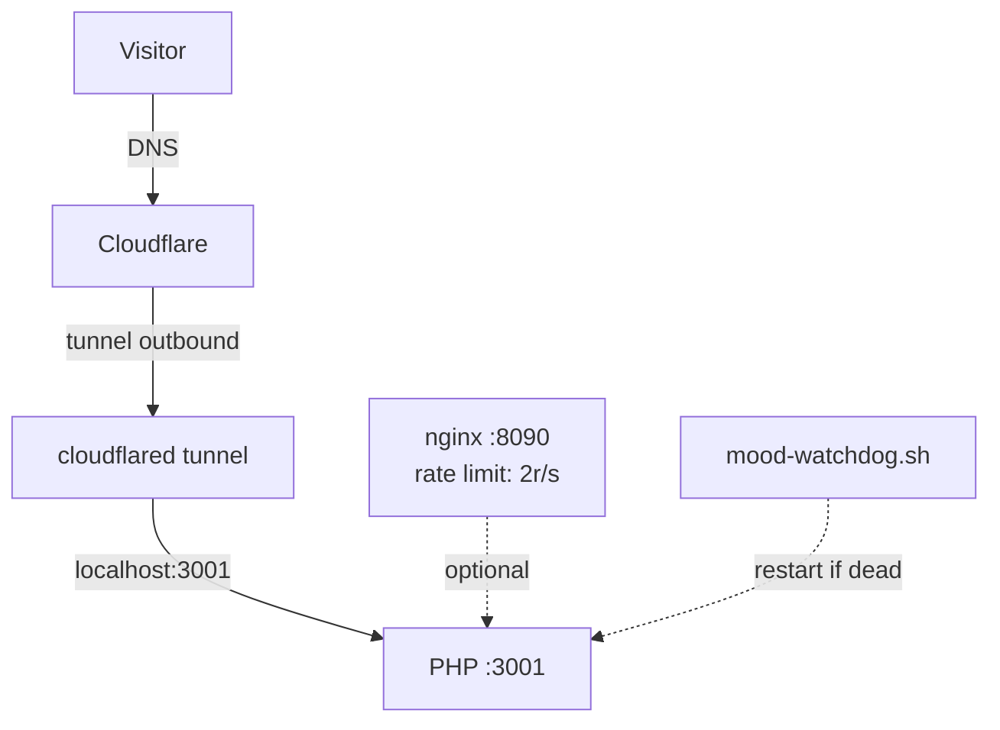

# Mood — Inspiration Gallery

Simple, minimal image gallery with infinite scroll.
Zero dependencies (vanilla JS + PHP).
Like [mood.nonlinear.nyc](https://mood.nonlinear.nyc) but you bring your own image folder.

## Download

```bash
git clone https://github.com/nonlinear/mood
cd mood
```

## 🎨 Personalize

Edit `config.json`:

```json
{
  "imagesDir": "images",
  "siteName": "mood",
  "siteUrl": "http://localhost:3001",
  "siteLink": "https://nonlinear.nyc",
  "rateLimit": {
    "maxRequests": 30,
    "windowSeconds": 10
  }
}
```

| Field | What it does |
|---|---|
| `imagesDir` | Path to your images (relative to project root, or absolute) |
| `siteName` | Name shown in `<title>`, PWA, and menu |
| `siteUrl` | Base URL for PWA manifest |
| `siteLink` | Link the globe icon in the menu opens |
| `rateLimit` | Max requests per IP per time window |

## ▶️ Run

```bash
php -S localhost:3001 router.php
```

Open **http://localhost:3001**

## 🌐 Making it public — Cloudflare Tunnel

This is how [mood.nonlinear.nyc](https://mood.nonlinear.nyc) is served.



### How it works

- **Cloudflare Tunnel** instead of port forwarding. The Mac Studio initiates an
  outbound connection to Cloudflare. No inbound port is ever opened.
- **Rate limit** (nginx: 2 req/s, burst 5) applies to navigation and API only.
  Images load freely — no throttling on scroll.
- **Watchdog** (`mood-watchdog.sh`) checks PHP every 10s with `kill -0` and
  restarts it if dead. Launched via `crontab @reboot`.
- **Threat model:** protects against IP discovery, port scanning, directory
  traversal, scrape abuse, and crash downtime. Does not protect against PHP
  vulnerabilities, macOS compromise, physical theft, or compromised Cloudflare
  credentials.


## Notes

- Supports: JPG, PNG, GIF, WebP
- Folder-friendly: no database needed — the filesystem is the index
